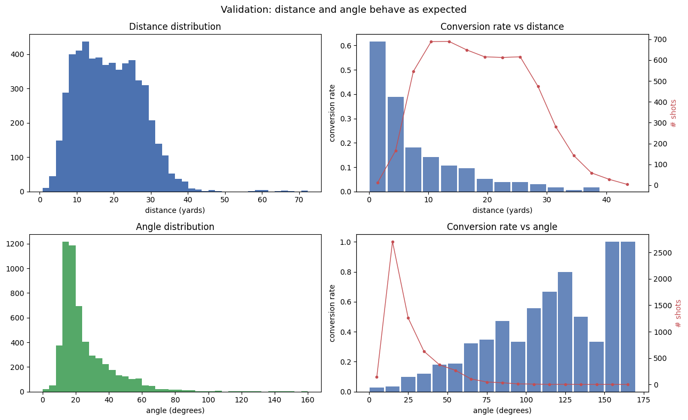
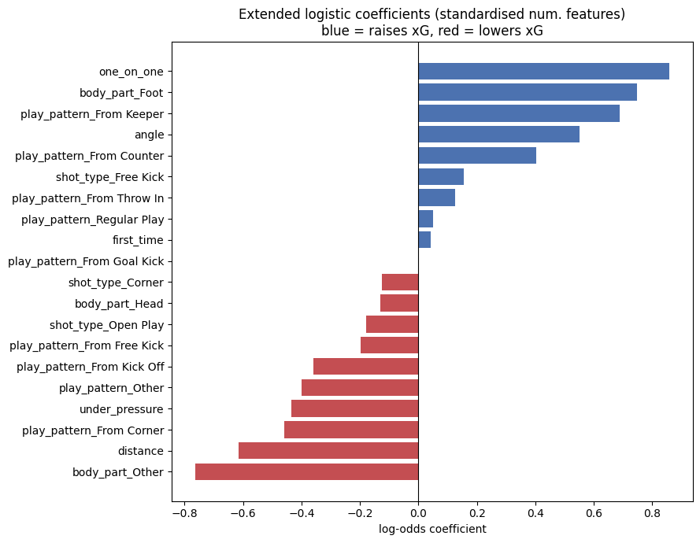
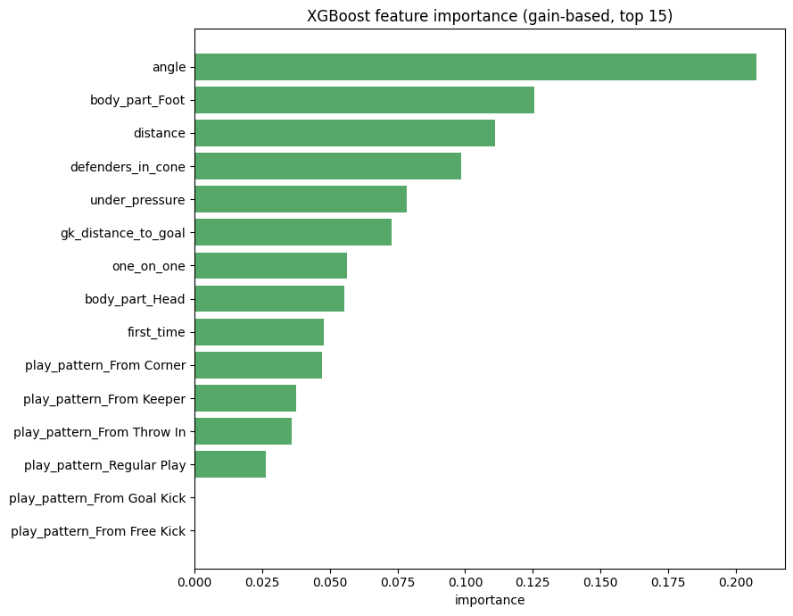
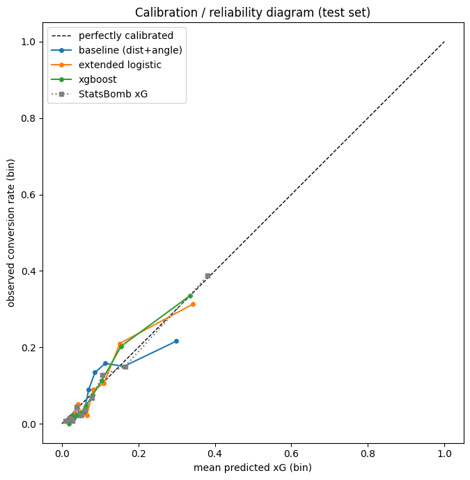
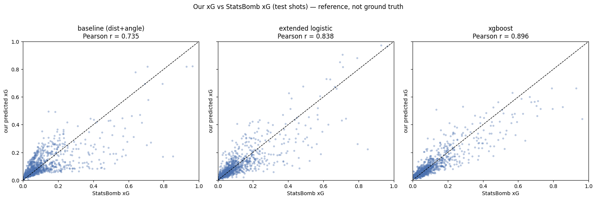
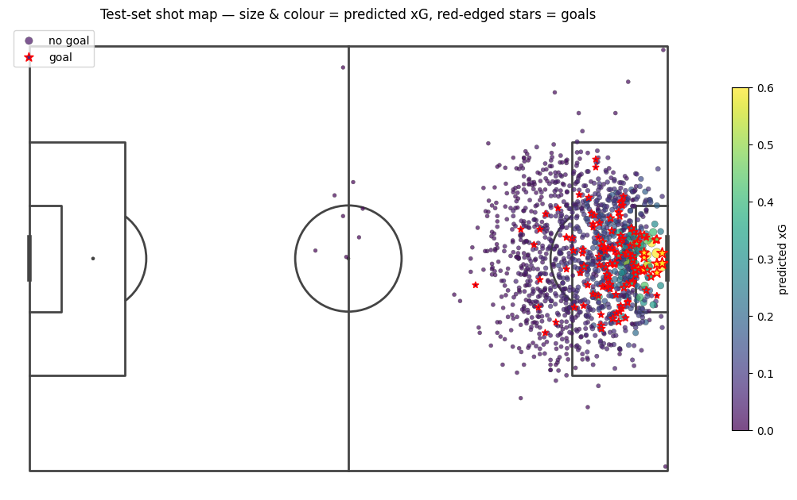
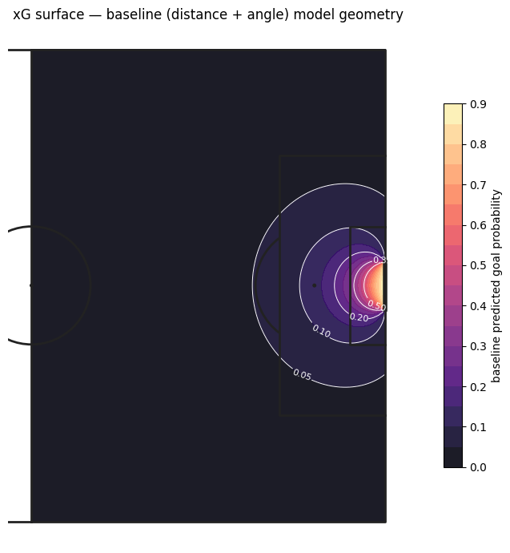

# Research note: an Expected Goals model built from first principles

This note explains how the model in `xg_model_from_scratch.ipynb` is built, why
each choice was made, and what the results say. It is meant to be readable on its
own. Every number quoted here is produced by a visible cell in the notebook.

## 1. Question and approach

Expected Goals (xG) assigns each shot a probability of becoming a goal, based on
the situation the shot was taken in. Summed over many shots it measures chance
quality, separate from whether the chances were actually finished.

The build order follows David Sumpter's teaching. Start with a model a person can
read: a logistic regression on shot distance and angle. Interpret its
coefficients in plain language. Only then add context features and, finally, a
gradient boosting model. Interpretability and calibration are the priorities, not
squeezing out the last point of AUC.

## 2. Data

Source: StatsBomb free open data, read through the `mplsoccer` Sbopen parser. No
login and no paid API.

The notebook first prints every competition and season available in the open
data, then selects four recent men's international tournaments:

- FIFA World Cup 2018
- FIFA World Cup 2022
- UEFA Euro 2020
- UEFA Euro 2024

Reasons for this set. All four have full tournament coverage, so there is no
team-selection bias like the partial club seasons in the open data, where only
one club's matches are present. All four are post-2018, which keeps the laws and
playing style consistent and avoids mixing very different eras. Every match ships
shot freeze-frames, which makes the optional defender and goalkeeper features
possible.

The pull covers 230 matches and 5,829 shots.

## 3. Cleaning and target

The target is binary: goal or no goal. The exact outcome label is confirmed by
inspecting the data rather than assumed. In these events the goal label is the
string `Goal`, and it accounts for the positive class.

Decisions recorded in the notebook:

- Penalties are dropped. A penalty is a fixed-geometry shot from twelve yards with
  no defenders, and its scoring rate is close to constant. Keeping penalties would
  distort the distance and angle relationship for open-play shots. This removes
  223 shots.
- Own goals do not appear. In StatsBomb an own goal is a separate event type, not
  a shot, so filtering to shots already excludes them. The notebook verifies that
  no own-goal outcome leaks into the shot table.
- Set-piece shots are kept and flagged. Direct free kicks and shots that come from
  corners or free kicks in open play stay in the data, with their situation
  recorded through `sub_type_name` and `play_pattern_name` so the models can use
  that context.

After cleaning there are 5,606 shots and 507 goals, an overall conversion rate of
9.0 percent.

## 4. Feature engineering

All features come from raw shot location and shot metadata, computed in the
notebook. Each one is validated with a distribution plot and a plot of conversion
rate by binned value, so it is clear the feature behaves sensibly before it goes
into a model.

### 4.1 Pitch geometry

StatsBomb uses a 120 by 80 pitch in units it calls yards. The goal is 8 units
wide, centred on the goal line at y = 40. That places the goalposts at (120, 36)
and (120, 44) and the goal centre at (120, 40). This is not taken on trust. The
notebook checks it against the data: every goal must cross the line at x = 120
with y between the posts, and it does.

Events are always oriented so the attacking team shoots toward x = 120. The
notebook confirms this by checking that the median shot x sits deep in the
attacking half. A small number of long-range shots come from the defensive half,
around 0.2 percent of the data. They are kept and simply receive very low xG.

### 4.2 Distance

Euclidean distance from the shot to the goal centre:

    distance = sqrt((120 - x)^2 + (40 - y)^2)

### 4.3 Angle

The angle is the angle subtended at the shot location by the two goalposts, that
is, how much of the goal mouth the shooter can see. With posts at
P_a = (120, 36) and P_b = (120, 44), and the shot at S = (x, y), form the vectors
from the shot to each post:

    a = P_a - S
    b = P_b - S

The angle between them is computed with the numerically stable atan2 form, which
is equivalent to the law of cosines and is well defined for any shot position:

    angle = atan2(|a x b|, a . b)

where a . b is the dot product and a x b is the 2D cross product. The result lies
between 0 and pi. A shot on the goal line between the posts subtends a large
angle; a shot from a tight angle out wide subtends a small one.

Two checks confirm the function. A shot at the penalty spot, twelve yards out and
central, gives 36.9 degrees, which matches the exact value 2 x atan(4 / 12). A
shot just in front of the centre of the goal returns an angle approaching pi.

The top row is distance, the bottom row is angle. The left panels show the raw
distributions: most shots come from 10 to 25 yards and from angles below 40
degrees. In the right panels the blue bars are conversion rate by bin and the red
line is the number of shots in each bin. Conversion falls steeply with distance,
from above 30 percent inside a few yards to near zero beyond 30. It rises with
angle. The far-right angle bins reach very high rates but the red line shows they
hold almost no shots, so they are noisy and carry little weight. Both curves have
the monotonic shape an xG model should reproduce, which is the check that the
geometry functions are correct.

### 4.4 Context features

- Body part, grouped into foot, head, and other.
- Shot situation from `sub_type_name`: open play or free kick.
- Play pattern from `play_pattern_name`: regular play, from corner, from counter,
  from throw-in, and so on.
- Binary flags where present in the data: under pressure, first-time, one-on-one.

The validation tables show each of these moving conversion in a way that has a
clear football reading. First-time shots convert at 13.0 percent against 7.5
percent otherwise. One-on-ones convert at 24.0 percent against 8.4 percent. Being
under pressure lowers conversion to 7.1 percent from 9.6 percent. Headers convert
slightly higher than foot shots in raw terms because they tend to happen closer
to goal, which is exactly the kind of confound the distance feature is there to
separate out.

### 4.5 Freeze-frame features

For nearly every shot, StatsBomb records the position of all players at the moment
of the shot. From this the notebook derives two features:

- Number of opponents inside the triangle formed by the shot location and the two
  posts, computed with a point-in-triangle test.
- The goalkeeper's distance from the goal centre.

Coverage is 100 percent of the cleaned shots in this data. The validation is
clean: with no opponent in the cone, conversion is 30.7 percent; with one it is
12.1 percent; with two, 6.1 percent; and it keeps falling as the cone fills. These
features are optional in Sumpter's framing, so they feed only the gradient
boosting model, with median imputation and a missing indicator for any shot that
lacks a frame.

## 5. Train and test split

The split is by match, not by shot. Shots from the same game share teams,
tactics, and conditions, so splitting randomly by shot would leak information from
a game into both train and test. A grouped split on match id puts every match
wholly in one side. Training uses 4,272 shots across 172 matches; the test set is
1,334 shots across 58 matches. All preprocessing is fit on the training data only,
inside scikit-learn pipelines, so nothing from the test set influences the fit.

## 6. Models

### 6.1 Baseline logistic regression

Features: distance and angle only. Fitted coefficients in natural units:

- intercept: -2.007
- distance: -0.0623 per yard
- angle: +1.3292 per radian

Read as odds ratios, each extra yard of distance multiplies the odds of scoring
by 0.940, a 6.0 percent drop per yard, and the effect compounds, so five yards
farther out multiplies the odds by 0.732. Ten more degrees of shooting angle
multiplies the odds by 1.261. Distance does most of the work and angle refines it:
a central shot and a narrow-angle shot from the same distance are not equal, and
the angle term is what separates them.

Sample predictions from this model line up with intuition. A shot from the six
yard box, central, gets about 0.31. A shot from the edge of the box, central,
gets about 0.07. A shot from 25 yards gets about 0.04. A shot from a tight angle
near the byline gets about 0.07. This two-feature model is already a credible xG
model.

### 6.2 Extended logistic regression

Adds body part, shot situation, play pattern, and the three context flags, one-hot
encoded inside a ColumnTransformer. The comparison to the baseline uses log loss
and AIC rather than AUC alone, because AIC rewards fit while penalising extra
parameters, which is the right test for whether added complexity earns its place.

- Baseline: 3 parameters, training AIC 2344.7, test log loss 0.2645.
- Extended: 21 parameters, training AIC 2263.0, test log loss 0.2475.

Lower AIC and lower test log loss mean the context features add genuine,
non-overfit signal beyond geometry.

The bars are the fitted log-odds coefficients, blue where a feature raises xG and
red where it lowers xG. Distance and angle are standardised, so their bars are
comparable in length to the one-hot terms. A one-on-one, a foot shot, and a wide
angle push xG up the most. Distance, a shot under pressure, and a shot from a
corner pull it down. The signs read the way a football analyst would expect, which
is the reason for keeping an interpretable model in the mix rather than only a
black box.

### 6.3 Gradient boosting

XGBoost on the full feature set including the freeze-frame features. Tuning is
light and uses group-aware cross-validation, with GroupKFold on match id so the
same match never sits in both a training and validation fold. The selected
settings were a max depth of 2, a learning rate of 0.03, and 200 trees, with a
cross-validated log loss of 0.2631.

Gain-based importance for the top features. Angle and distance lead, followed by
whether the shot was a foot shot, the number of defenders in the cone, whether the
shooter was under pressure, and the goalkeeper's distance from goal. The two
freeze-frame features earn real weight, which is the practical reason the boosted
model pulls closer to StatsBomb than the geometry-only baseline can.

## 7. Evaluation

All metrics are on the held-out test set.

| Model | Log loss | Brier | ROC-AUC |
|---|---|---|---|
| Baseline logistic | 0.2645 | 0.0736 | 0.746 |
| Extended logistic | 0.2475 | 0.0698 | 0.796 |
| XGBoost | 0.2414 | 0.0680 | 0.814 |
| StatsBomb xG (reference) | 0.2313 | 0.0652 | 0.828 |

The ordering is consistent across all three metrics and moves toward the StatsBomb
reference at each step.

### 7.1 Calibration

The reliability diagram is the most important plot in the notebook. Points on the
diagonal mean predicted xG equals observed conversion in that bin. All three
models track the diagonal closely in the low-xG region, where most shots sit. The
baseline drifts furthest in the highest bin, predicting about 0.30 where the
observed rate is about 0.21, because geometry alone cannot tell an open net from a
crowded one. The extended and boosted models stay closer to the diagonal and to
StatsBomb. Good calibration is what makes it valid to sum the predictions.

### 7.2 Aggregate check

Summed predicted xG against actual goals on the test set:

- Actual goals: 116
- Baseline: 124.4
- Extended: 123.4
- XGBoost: 122.2
- StatsBomb: 125.4

All four sit within about 5 to 8 percent of the actual count, and StatsBomb's own
model is on the same side, slightly over the actual figure. Per team the totals
track actual goals as well, for example Spain with 17 goals against roughly 19 to
20 xG across the models.

### 7.3 Benchmark against StatsBomb

StatsBomb ships its own xG per shot, which the notebook treats as a strong
reference rather than ground truth. Its model uses richer inputs than the baseline
here: full freeze-frame geometry, goalkeeper positioning, shot technique, and the
type and height of the assist. The per-shot scatter shows the baseline correlating
strongly but compressing toward the middle, since it cannot separate an open net
from a crowded one at the same distance and angle. The extended and boosted
models, which can see defenders in the cone and the keeper's distance, track
StatsBomb more tightly. The largest disagreements are exactly the shots where
off-ball context matters most, such as point-blank chances with defenders on the
line and clear one-on-ones.

Each panel plots one model's per-shot xG against StatsBomb's, with the dashed line
marking exact agreement. The correlation rises from 0.735 for the baseline to
0.838 for the extended model and 0.899 for XGBoost. The baseline sits mostly below
the line at the high end, because without off-ball context it cannot rate a clear
chance as highly as StatsBomb does, so its points compress toward the middle. The
boosted model sits much tighter around the line.

### 7.4 Shot map and xG surface

The shot map places every test-set shot on the pitch, sized and coloured by the
extended model's predicted xG, with goals marked as red-edged stars. The high-xG
points cluster in the six yard box and centrally, and most goals sit in that same
region. This is the calibration result seen on the pitch rather than in a chart.

The xG surface is the baseline model's predicted goal probability evaluated across
the attacking half. It makes the model's geometry explicit. Probability is highest
right in front of goal and falls off with distance, and the contours pinch inward
toward the byline near each post, which is the angle term at work. A shot from wide
near the goal line is worth less than one from the same distance centrally, exactly
as the coefficients say.

## 8. What drives xG

Distance first, then angle. The two-feature baseline captures most of the signal
and is well calibrated. Shot context, meaning body part, situation, play pattern,
pressure, first-time, and one-on-one, adds a real but secondary improvement. The
freeze-frame features, which encode who is in the way, are what let the boosted
model close most of the remaining gap to StatsBomb.

## 9. Limitations

- Trained on four men's international tournaments only. Style and finishing may not
  transfer to club football or the women's game without refitting.
- No shot technique such as volley or half-volley, no assist type or height, no
  explicit goalkeeper angle, only distance, and no defender pressure distance.
- Freeze-frame features are absent for a small fraction of shots in general, and
  are imputed when missing.
- xG models chance quality, not finishing skill. Per-player finishing effects are
  deliberately not modelled.

## 10. What to add next

- Shot technique and the assist type and height.
- Goalkeeper position relative to the shot line, not just distance to the goal
  centre.
- Distance to the nearest defender.
- A dedicated recalibration layer, for example isotonic or Platt scaling, on the
  boosted model.
- Cross-competition validation, training on internationals and testing on a club
  league, to measure how well the model transfers.

## Reproducibility

Seeds are fixed. The competitions pulled are listed above and printed in the
notebook. Library versions are pinned in `requirements.txt` and printed in the
first code cell. The full environment is Python 3.12 with numpy 2.4.6, pandas
3.0.3, scipy 1.17.1, scikit-learn 1.9.0, mplsoccer 1.6.1, xgboost 3.3.0, and
statsbombpy 1.19.0.
